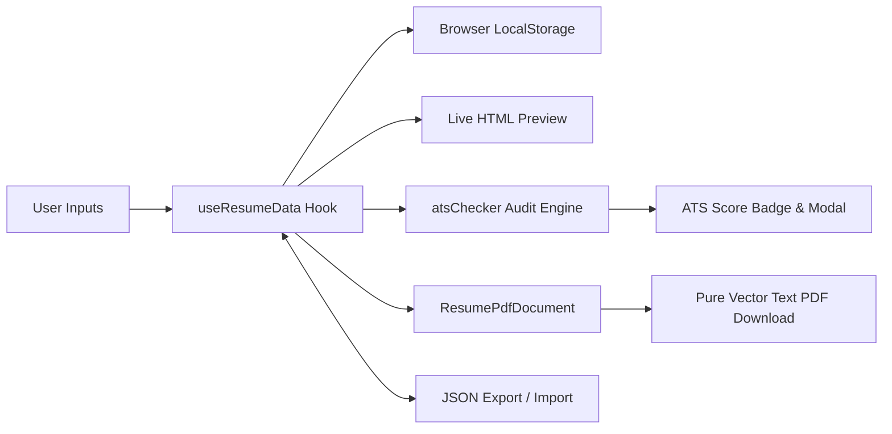

# Resume Flow 📄✨

> **Modern, Free, and Privacy-First ATS-Friendly Resume Builder** with real-time scoring audit and pure vector text PDF export.

[](https://nextjs.org/)
[](https://react.dev/)
[](https://tailwindcss.com/)
[](https://www.typescriptlang.org/)
[](https://react-pdf.org/)
[](#-privacy--security)
[](LICENSE)

---

## 📌 Table of Contents

- [Overview](#-overview)
- [Why ATS-Friendly Matters](#-why-ats-friendly-matters)
- [Key Features](#-key-features)
- [Template Showcase](#-template-showcase)
- [ATS vs. Graphic CV Comparison](#-ats-vs-graphic-cv-comparison)
- [Tech Stack](#-tech-stack)
- [Project Architecture](#-project-architecture)
- [Getting Started](#-getting-started)
- [Application Data Flow](#-application-data-flow)`
- [Resume Optimization Guidelines](#-resume-optimization-guidelines)
- [Privacy & Security](#-privacy--security)
- [License](#-license)

---

## 🌟 Overview

**Resume Flow** is an open-source web application designed to help job seekers create professional, clean, and highly effective resumes that pass **Applicant Tracking Systems (ATS)** such as Workday, Taleo, Greenhouse, and Lever with ease.

Most graphic CV templates (e.g., from Canva or Photoshop) utilize multi-column designs, tables, icons, and non-standard layouts that cause ATS parsers to misread or discard qualifications. **Resume Flow** solves this by generating **pure vector text PDFs** while providing a live **0–100 ATS Audit Score** that guides candidates to write high-impact bullet points using strong action verbs and quantifiable metrics.

---

## 🎯 Why ATS-Friendly Matters

Over **75% of resumes are automatically screened and ranked by ATS algorithms** before any human recruiter reads them. Common issues that cause automatic rejection:

- ❌ **Complex multi-column tables and text boxes**: Parsers read across columns left-to-right, mixing up dates, job titles, and duties.
- ❌ **Raster images and graphics**: Text embedded in images cannot be indexed or searched.
- ❌ **Missing industry keywords**: Resumes lacking standardized headings (e.g., "Work Experience", "Education") confuse parsing algorithms.
- ❌ **Lack of measurable impact**: Bullet points without strong action verbs or quantifiable metrics rank lower.

**Resume Flow** guarantees single-column, structured, text-based PDF exports with standardized metadata that parsing software can ingest with 100% fidelity.

---

## 🚀 Key Features

### 1. 🛡️ Real-Time ATS Audit Engine (0–100 Score)

- **Instant Feedback**: Live score calculated automatically as you type.
- **Action Verbs Scanner**: Checks for high-impact action verbs (e.g., _Architected_, _Spearheaded_, _Optimized_, _Reduced_).
- **Measurable Metrics Detector**: Identifies quantifiable achievements, percentages, multipliers, and numbers.
- **Contact & Content Checklist**: Ensures full contact information, balanced summary word count (25–120 words), structured education, and categorized skills.
- **Detailed Audit Modal**: Interactive checklist breaking down scores per category with tips for improvement.

### 2. 🖨️ Pure Text Vector PDF Export

- Engineered with `@react-pdf/renderer` v4 for client-side document synthesis.
- **100% Selectable & Searchable**: Real text streams (Ctrl+F ready), not screenshot canvas renders or rasterized graphics.
- **Zero Watermarks & Zero Fees**: Clean, professional PDFs ready for immediate submission.

### 3. 🎨 3 ATS-Optimized Templates

- **ATS Classic Standard**: Centered header, clean horizontal dividers, and balanced margins. Perfect for corporate, banking, government, legal, and traditional industries.
- **ATS Modern Tech**: Left-aligned accent header, categorized skill tags, and crisp typography. Ideal for software engineers, product managers, and tech startups.
- **ATS Minimalist Clean**: Ultra-streamlined monochrome layout maximizing text density. Designed for senior candidates wanting to fit extensive careers into a single page.

### 4. 🎛️ Typography & Layout Fine-Tuning

- **Standard ATS-Safe Fonts**: Helvetica (sans-serif), Times-Roman (serif), and Courier (monospace).
- **Font Scaling**: Small (9.5pt), Medium (10pt), or Large (11pt).
- **Spacing Density**: Compact, Normal, or Spacious to ensure your resume fits neatly onto exactly one page.
- **Subtle Accent Colors**: Curated ATS-safe palettes (Charcoal, Deep Navy, Teal, Slate).
- **Divider Toggle**: Enable or disable horizontal section border lines.

### 5. 🔀 Dynamic Section Management

- Reorder sections effortlessly (Summary, Work Experience, Education, Skills, Projects, Certifications).
- Customize section heading titles (e.g., rename "Work Experience" to "Professional Experience").
- Toggle visibility of optional sections on or off without deleting underlying data.

### 6. 🔒 100% Client-Side Privacy & Offline Persistence

- **No Sign-Up or Login Required**: Zero barrier to entry.
- **Zero Database Storage**: All personal information stays on your device.
- **Auto-Save via LocalStorage**: Never lose progress when refreshing or closing the browser.
- **One-Click JSON Portability**: Export your resume data to a JSON backup file and restore it on any device.

### 7. 🧪 Sample Data & Clean Slate

- Pre-loaded with high-impact software engineer sample data demonstrating the STAR method.
- Quick reset button to start fresh whenever desired.

---

## 📄 Template Showcase

| Template           | Style Focus               | Best Suited For                                | Key Characteristics                                               |
| :----------------- | :------------------------ | :--------------------------------------------- | :---------------------------------------------------------------- |
| **ATS Classic**    | Standard & Formal         | Corporate, Finance, BUMN, Legal, Healthcare    | Centered header, horizontal dividers, universal ATS compatibility |
| **ATS Modern**     | Contemporary & Tech-Savvy | Software Engineering, UI/UX, Product, Startups | Subtle left accent bar, category badges, modern spacing           |
| **ATS Minimalist** | High Density & Clean      | Senior Roles, Executives, Academics            | No decorative lines, maximum content density, compact 1-page fit  |

---

## ⚖️ ATS vs. Graphic CV Comparison

| Criteria                      |          Graphic / Canva CV           |          Resume Flow ATS Resume           |
| :---------------------------- | :-----------------------------------: | :---------------------------------------: |
| **Parsing Success Rate**      |    ⚠️ ~20% – 40% (Frequent errors)    |      ✅ **99% – 100% (Native text)**      |
| **Document Format**           |    Often raster PDF / Image canvas    |         **Pure Vector Text PDF**          |
| **Layout Structure**          |  Multi-column, text boxes, graphics   |   **Standard single-stream hierarchy**    |
| **Text Selectability**        |       Inconsistent / Flattened        | **Fully selectable & Ctrl+F searchable**  |
| **Skill Rating Bars / Stars** |    ❌ Unreadable by ATS algorithms    | ✅ **Standardized comma-separated lists** |
| **Privacy & Security**        |    Cloud account & server storage     |   🔒 **100% Client-side local storage**   |
| **Cost & Watermarks**         | Often requires subscription/watermark |      🆓 **100% Free, no watermarks**      |

---

## 💻 Tech Stack

- **Framework**: [Next.js 16](https://nextjs.org/) (App Router architecture)
- **UI Library**: [React 19](https://react.dev/) & React DOM
- **Styling**: [Tailwind CSS v4](https://tailwindcss.com/) with PostCSS
- **PDF Engine**: [`@react-pdf/renderer` v4](https://react-pdf.org/)
- **Icons**: [Lucide React](https://lucide.dev/)
- **Language**: [TypeScript 5](https://www.typescriptlang.org/)
- **Package Manager**: [pnpm](https://pnpm.io/)

---

## 📁 Project Architecture

```text
resume-builder/
├── app/
│   ├── layout.tsx             # Root HTML layout with Geist font & metadata
│   ├── page.tsx               # Landing page (Hero, Demo, Comparison, Features, FAQ)
│   ├── globals.css            # Tailwind CSS v4 directives & theme configurations
│   └── builder/
│       └── page.tsx           # Main application builder (split editor + live preview)
├── components/
│   ├── editor/                # Form controls for every resume section
│   │   ├── PersonalInfoForm.tsx
│   │   ├── ExperienceForm.tsx
│   │   ├── EducationForm.tsx
│   │   ├── SkillsForm.tsx
│   │   ├── ProjectsForm.tsx
│   │   ├── CertificationsForm.tsx
│   │   ├── SectionManager.tsx
│   │   └── StyleSettingsForm.tsx
│   ├── landing/               # Interactive landing page sections
│   │   ├── LandingNavbar.tsx
│   │   ├── HeroSection.tsx
│   │   ├── InteractiveDemoSection.tsx
│   │   ├── AtsComparisonSection.tsx
│   │   ├── FeaturesGridSection.tsx
│   │   ├── TemplatesShowcaseSection.tsx
│   │   ├── StepByStepSection.tsx
│   │   ├── FaqSection.tsx
│   │   ├── CtaBannerSection.tsx
│   │   └── LandingFooter.tsx
│   ├── layout/
│   │   └── Navbar.tsx         # Builder top navigation with ATS score & actions
│   ├── modals/
│   │   ├── AtsScoreModal.tsx        # In-depth ATS score breakdown & tips
│   │   ├── ImportExportModal.tsx    # JSON import/export interface
│   │   └── ResetConfirmModal.tsx    # Confirmation dialog for clearing data
│   ├── pdf/
│   │   ├── ResumePdfDocument.tsx    # React-PDF vector document implementation
│   │   └── PdfDownloadButton.tsx    # Dynamic PDF generation & download trigger
│   └── preview/
│       └── ResumePreview.tsx        # High-fidelity live HTML preview matching PDF output
├── data/
│   └── sampleResume.ts        # Pre-configured sample resume & default settings
├── hooks/
│   └── useResumeData.ts       # Central custom hook: CRUD, localStorage, reordering
├── types/
│   └── resume.ts              # Core TypeScript interfaces & types
├── utils/
│   └── atsChecker.ts          # ATS scoring calculation & action verb evaluator
├── package.json
└── tsconfig.json
```

---

## 🛠️ Getting Started

### Prerequisites

Ensure you have the following installed:

- [Node.js](https://nodejs.org/) (version `20.x` or higher recommended)
- [pnpm](https://pnpm.io/) (`>= 9.0.0` or install via `npm i -g pnpm`)

### Installation

1. **Clone the repository:**

   ```bash
   git clone https://github.com/your-username/resume-builder.git
   cd resume-builder
   ```

2. **Install dependencies:**

   ```bash
   pnpm install
   # or: npm install / yarn install / bun install
   ```

3. **Start the development server:**

   ```bash
   pnpm dev
   ```

4. **Open in your browser:**
   Navigate to [http://localhost:3000](http://localhost:3000) to view the landing page, or go directly to [http://localhost:3000/builder](http://localhost:3000/builder) to begin building your resume.

### Build for Production

To create an optimized production build:

```bash
pnpm build
pnpm start
```

---

## 🔄 Application Data Flow



1. **Input & State**: Data is entered through section-specific forms in the editor panel.
2. **Persistence**: `useResumeData` synchronizes state changes with `localStorage` in real time.
3. **Live Preview**: The right-hand preview panel renders a high-fidelity replica mirroring PDF styles.
4. **Audit Engine**: `analyzeAtsScore` continuously evaluates metrics, verbs, and completeness.
5. **PDF Generation**: `@react-pdf/renderer` generates an uncompressed, vector-based PDF directly in the browser.

---

## 💡 Resume Optimization Guidelines (STAR Method)

To achieve a 90+ ATS Score in Resume Flow:

- **Situation & Task**: Contextualize the challenge or project.
- **Action**: Start each bullet point with a powerful past-tense action verb (_Designed_, _Architected_, _Implemented_, _Reduced_).
- **Result**: Include at least one concrete metric or percentage:
  - _Good_: "Improved database query speeds."
  - _Great_: "Optimized PostgreSQL indexes and query plans, reducing API p95 response time by 48% across 2M daily queries."
- **Summary Length**: Keep your professional summary between 25 and 120 words (2–4 punchy sentences).
- **Skills Formatting**: Group skills logically (e.g., Languages, Frameworks, Cloud & DevOps).

---

## 🔐 Privacy & Security

- **Zero Remote Storage**: Your contact details, work history, and achievements are never transmitted to external servers.
- **No Third-Party Analytics / Trackers**: Your browsing and typing activities remain private.
- **Full Data Ownership**: You can export, backup, or wipe your data at any time via the builder controls.

---

## 📄 License

This project is licensed under the [MIT License](LICENSE) — feel free to use, modify, and contribute!
